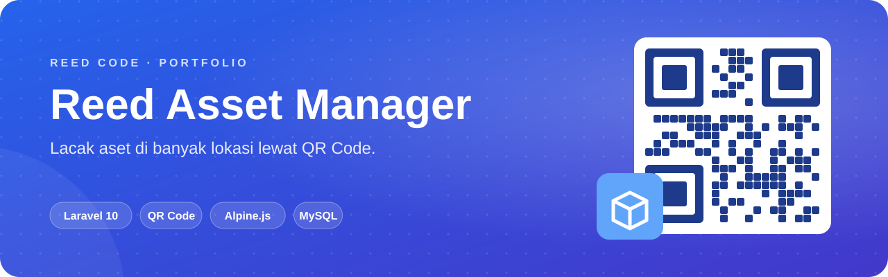
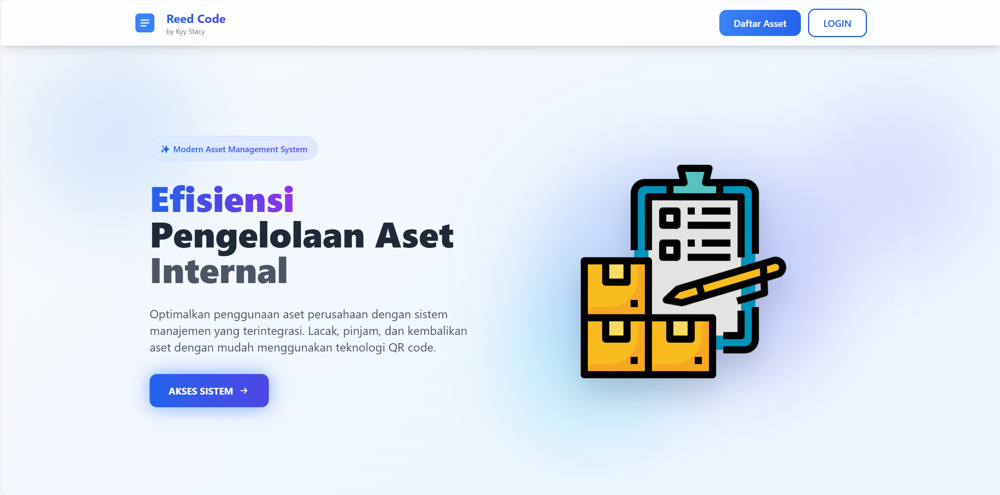
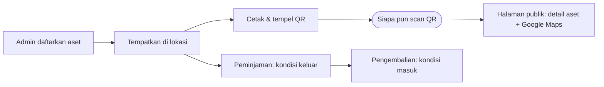

<p align="center">
  
</p>

<p align="center">
  <b>Setiap aset punya identitas, setiap identitas punya QR.</b> Sistem manajemen aset multi-lokasi untuk melacak, meminjamkan, dan memeriksa kondisi barang dalam sekali scan.
</p>

<p align="center">
  <a href="#sekilas">Sekilas</a> ·
  <a href="#kemampuan">Kemampuan</a> ·
  <a href="#alur-kerja">Alur Kerja</a> ·
  <a href="#mulai-menjalankan">Mulai Menjalankan</a> ·
  <a href="#akun-demo">Akun Demo</a>
</p>

<p align="center">
  
  <br>
  
  
</p>

## Sekilas

**Reed Asset Manager** dirancang untuk organisasi yang asetnya tersebar di banyak tempat. Satu aset bisa ditempatkan di beberapa lokasi, dan **setiap penempatan mendapat kode identitas serta QR Code** sendiri. Hasil scan membuka halaman publik berisi detail aset dan lokasinya, tanpa perlu login.

<p align="center">
  
</p>

## Kemampuan

<table>
  <tr>
    <td width="50%" valign="top"><b>📊 Dashboard Ringkas</b><br>Total aset, unit dipinjam & tersedia, tingkat penggunaan, jumlah lokasi & kategori, serta aktivitas aset terbaru.</td>
    <td width="50%" valign="top"><b>📦 Katalog Aset</b><br>Kelola aset per kategori, lengkap dengan pencarian.</td>
  </tr>
  <tr>
    <td valign="top"><b>📍 Multi-Lokasi + GPS</b><br>Setiap lokasi punya koordinat dan langsung terbuka di Google Maps.</td>
    <td valign="top"><b>🏷️ Cetak QR Code</b><br>QR unik untuk setiap aset di setiap lokasi, siap ditempel.</td>
  </tr>
  <tr>
    <td valign="top"><b>🔄 Peminjaman</b><br>Catat aset keluar dan masuk beserta kondisi saat dipinjam dan dikembalikan.</td>
    <td valign="top"><b>👥 Pengguna & Role</b><br>Role <code>admin</code> dan <code>karyawan</code>, foto profil, dan status online.</td>
  </tr>
</table>

## Alur Kerja



| Tabel | Isi |
|---|---|
| `asset_categories` | Kategori aset |
| `assets` | Data master aset |
| `locations` | Lokasi + koordinat GPS |
| `location_assets` | Penempatan aset + kode identitas (QR) |
| `asset_transactions` | Peminjaman & pengembalian + kondisi barang |

## Mulai Menjalankan

> Butuh **PHP 8.1+**, **Composer**, **Node.js 16+**, dan **MySQL**.

```bash
git clone https://github.com/KyyStacy/asset-inventory-qr-laravel.git
cd asset-inventory-qr-laravel

composer install && npm install
cp .env.example .env && php artisan key:generate
# isi DB_DATABASE, DB_USERNAME, DB_PASSWORD di .env

php artisan migrate --seed
php artisan storage:link

npm run dev            # terminal 1
php artisan serve      # terminal 2  →  http://localhost:8000
```

Seeder sudah menyiapkan contoh aset seperti laptop, proyektor, kendaraan operasional, dan peralatan kerja.

## Akun Demo

Semua akun memakai password `password`.

| Role | Email |
|---|---|
| Admin | `admin@reedcode.id` |
| Karyawan | `budi.santoso@reedcode.id` · `siti.nurhaliza@reedcode.id` · `ahmad.rizki@reedcode.id` |

---

<div align="center">

<h2>Dibuat oleh Kyy Stacy × Reed Code</h2>

<p><i>Web & app developer: dari landing page sampai sistem bisnis custom.</i></p>

<a href="https://www.instagram.com/reedcode.id"></a>
<a href="https://www.tiktok.com/@reedcode.id"></a>
<a href="https://github.com/KyyStacy"></a>

<br><br>

<table>
  <tr>
    <td colspan="4" align="center"><b>Punya ide aplikasi atau butuh website untuk bisnismu?</b><br><sub>Reed Code siap bantu dari desain sampai online.</sub></td>
  </tr>
  <tr>
    <td align="center" width="25%">🌐<br><b>Company Profile</b><br><sub>Website brand & usaha</sub></td>
    <td align="center" width="25%">🛒<br><b>Toko Online</b><br><sub>Katalog & pembayaran online</sub></td>
    <td align="center" width="25%">📊<br><b>Sistem Bisnis</b><br><sub>Kasir, inventaris, booking</sub></td>
    <td align="center" width="25%">📱<br><b>Aplikasi Mobile</b><br><sub>Android & iOS</sub></td>
  </tr>
</table>

<a href="https://wa.me/6285171713355?text=Halo%20Reed%20Code%2C%20saya%20tertarik%20dengan%20jasa%20pembuatan%20website"></a>

<br><br>

<sub>© 2026 Kyy Stacy · Reed Code</sub>

</div>
